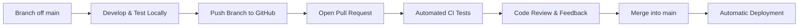

# TasksManager GitHub Collaboration & Pull Request Guide

Best practices for team collaboration, code reviews, Pull Requests, issue tracking, and release management on GitHub for the **TasksManager** project.

---

## 1. The Pull Request (PR) Lifecycle

Pull Requests provide an isolated, reviewable space where changes are discussed, automatically tested, and verified before merging into `main`.



---

## 2. Opening an Effective Pull Request

When opening a Pull Request on GitHub:
1. **Title**: Follow the Conventional Commit format ($\le 50$ chars, imperative, plain English).
2. **Draft PRs**: If your work is still ongoing, click the dropdown next to "Create Pull Request" and select **Create Draft Pull Request**. This signals that reviews and auto-merges are not yet needed.
3. **Description**: Use a structured format that explains the change to reviewers.

### Standard PR Description Template
```markdown
## Summary
A concise 2-3 sentence overview of what was changed and why.

## Key Changes
- Replaced technical dropdown clipping with visible container overflow.
- Added direct 404 handler for `/status` route.
- Updated session gate check to verify status synchronously on refresh.

## How to Test
1. Navigate to `/status` directly in browser.
2. Verify the 404 page loads immediately without showing password input.
3. Refresh the page on protected routes to verify no password prompt flashes.

## Issue Linking
Fixes #42
```

---

## 3. Linking Issues & Automated Closures

Use official GitHub closing keywords in your PR description or commit footers to automatically close related issues when the PR merges:

| Keyword | Syntax Example | Behavior on Merge |
| :--- | :--- | :--- |
| **`Fixes`** | `Fixes #104` | Closes issue 104 automatically |
| **`Closes`** | `Closes #88` | Closes issue 88 automatically |
| **`Resolves`** | `Resolves #12` | Closes issue 12 automatically |
| **`Refs`** | `Refs #34` | Links the issue without closing it |

---

## 4. Code Review Etiquette

### For Authors
- Keep PRs small and focused (ideally $< 300$ lines changed). Large PRs take longer to review and hide subtle bugs.
- If a reviewer suggests changes, push follow-up commits to the same branch. They will automatically appear in the open PR.

### For Reviewers
- Check for adherence to project standards (clean comments, no AI artifacts, typed props).
- Verify edge-case handling (empty arrays, undefined values, mobile viewports).
- Approve explicitly when satisfied, or request changes with constructive explanations.

---

## 5. Tags, Releases & Semantic Versioning

When changes in `main` represent a milestone or stable release, mark the snapshot using an **annotated Git tag**:

### Semantic Versioning Rules (MAJOR.MINOR.PATCH)
- **MAJOR** (`v2.0.0`): Breaking changes requiring user reconfiguration or API migration.
- **MINOR** (`v1.2.0`): New features added in a backward-compatible manner.
- **PATCH** (`v1.2.1`): Backward-compatible bug fixes and small corrections.

### How to Create & Push a Release Tag
```bash
# 1. Ensure you are on latest main
git checkout main
git pull origin main

# 2. Create an annotated tag with release summary
git tag -a v1.3.0 -m "Release v1.3.0: Add week drilldown timeline and improved mobile navigation"

# 3. Push the tag to GitHub
git push origin v1.3.0

# 4. View all tags
git tag -n
```

Once pushed, navigate to **GitHub $\rightarrow$ Releases $\rightarrow$ Draft a new release** and select the tag to publish notes and downloadable archives.
