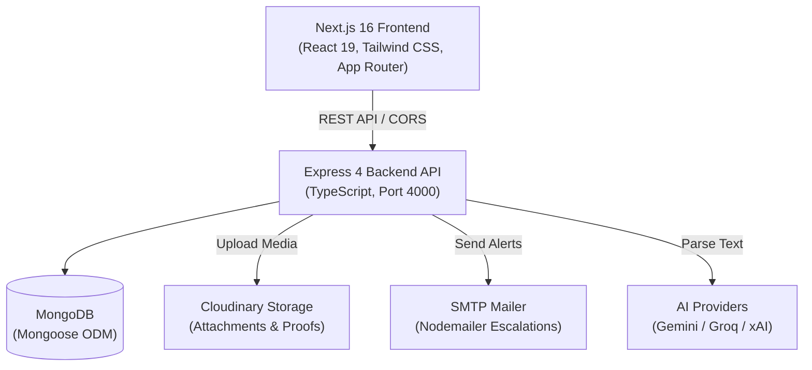

# TasksManager

A full-stack task management, communication follow-up tracking, and automated escalation system built with **Next.js 16**, **Express**, **TypeScript**, and **MongoDB**.

TasksManager is designed for engineering teams, project managers, and workflow coordinators who need granular timesheet tracking, communication logs with attachment proofs, AI-assisted task extraction, and automated managerial escalation when follow-up thresholds are exceeded.

---

## Problem & Purpose

Traditional task trackers often fall short in operations where tasks require continuous external communication (calls, emails, site meetings) and formal escalation rules:

1. **Granular Calendar Alignment**: Standard boards lack native support for drilling down into specific operational periods (Year → Month → 6-day Work Week → Day).
2. **Follow-Up Proof & Accountability**: Tasks that stall require verifiable interaction logs (call recordings, meeting notes, invoice proofs) with next-action dates.
3. **Escalation Gaps**: Without automated alerts, overdue tasks go unnoticed until deadlines fail.
4. **Fast Task Entry**: Logging tasks manually during field operations is slow. Converting informal notes and voice-to-text messages into structured records saves significant administrative time.
5. **Secure External Visibility**: Clients or department heads often need read-only progress views without requiring platform accounts or write permissions.

---

## Key Features

- **Cascading Date Filtering**: Drill down dynamically from Year to Month, Week (Monday–Saturday standard), or specific Day. Defaults automatically to the current active period.
- **Multilingual AI Task Extraction**: Parses unstructured notes (English, Hindi, Marathi, Hinglish, Roman Marathi) into structured task records with intelligent fallback across Gemini, Groq, and xAI (Grok).
- **Communication Follow-Up Tracking**: Log calls, WhatsApp messages, emails, and meetings with next scheduled contact dates and multimedia proof attachments.
- **Managerial Escalation Engine**: Automatically tracks follow-up counts against configured thresholds and dispatches HTML email notifications to Managers, HODs, and Deputy HODs.
- **Multi-Format In-Memory Exports**: Generate landscape PDF task registers, styled multi-sheet Excel workbooks, and consolidated ZIP archives containing tasks and attachment files.
- **Tokenized Public Status Portal**: Share real-time, read-only project dashboards with stakeholders via secure, revokable public tokens.
- **Client Session Security Gate**: Configurable PIN/password lock with automatic inactivity timeout and cross-tab synchronization via BroadcastChannel.

---

## Major Modules

### 1. Dashboard (`/`)
Provides a high-level operational pulse. Features interactive summary cards (Total, In Progress, Pending, Completed, Overdue, Escalated), an attention section highlighting urgent items, and cascading year/month/week scope selectors.

### 2. Task Workspace (`/tasks`)
The primary data grid for managing daily timesheet items. Supports inline status toggles, column sorting, search queries, priority tags, "Given By" person assignment, multi-task selection, and bulk exports.

### 3. Follow-Ups Module (`/follow-ups`)
A dedicated tracking workspace for items requiring ongoing communication. Displays an interactive timeline of all touchpoints, attachment thumbnails, next scheduled follow-up dates, and active escalation warnings.

### 4. Public Status Portal (`/status/[token]`)
A lightweight, mobile-responsive external view. Shows high-level task metrics and progress filters without exposing internal controls or sensitive system configuration.

### 5. Settings & Escalation Management (`/settings`)
Central configuration panel covering:
- **Escalation Rules**: Set alert threshold limits (e.g., alert manager after 3 touches) and manage To/CC/BCC recipient lists.
- **Security**: Update session password, customize inactivity auto-lock durations, or lock the session immediately.
- **AI Providers**: Configure fallback providers and custom API keys.
- **Sharing**: Enable or regenerate public status portal tokens.

---

## Architecture Overview



---

## Tech Stack

| Layer | Technologies |
| :--- | :--- |
| **Frontend** | [Next.js 16](https://nextjs.org/) (App Router, Turbopack), [React 19](https://react.dev/), [Tailwind CSS v4](https://tailwindcss.com/), [Lucide React](https://lucide.dev/) |
| **Backend** | [Node.js](https://nodejs.org/), [Express 4](https://expressjs.com/), [TypeScript](https://www.typescriptlang.org/) |
| **Database** | [MongoDB](https://www.mongodb.com/) via [Mongoose 8](https://mongoosejs.com/) |
| **AI Extraction** | [@google/genai](https://www.npmjs.com/package/@google/genai) (Gemini), Groq API, xAI API |
| **Document Generation** | [PDFKit](https://pdfkit.org/) (PDF register), [ExcelJS](https://github.com/exceljs/exceljs) (Spreadsheets), [Archiver](https://www.npmjs.com/package/archiver) (ZIP bundles) |
| **Media & Uploads** | [Multer](https://github.com/expressjs/multer), [Cloudinary](https://cloudinary.com/) (image, audio, document storage) |
| **Email Delivery** | [Nodemailer](https://nodemailer.com/) (HTML escalation templates) |
| **Testing** | [Playwright](https://playwright.dev/) (End-to-End browser test suite) |

---

## Project Structure

```
TasksManager/
├── package.json              # Monorepo scripts (concurrent execution, builds, linting)
├── .gitignore                # Unified root ignore rules
├── README.md                 # Public repository documentation
│
├── client/                   # Frontend Application (Next.js 16)
│   ├── app/                  # App Router routes (dashboard, tasks, follow-ups, settings, status)
│   ├── components/           # Feature components (auth, dashboard, follow-ups, tasks, modals, ui)
│   ├── context/              # Global state management (TaskContext.tsx)
│   ├── hooks/                # Custom React hooks (useTasks, useFollowUps, useEscalation, etc.)
│   ├── lib/                  # Utilities (api client, date calculations, session manager)
│   ├── types/                # TypeScript interface definitions
│   ├── public/               # Static brand assets and icons
│   ├── package.json
│   └── tsconfig.json
│
└── server/                   # Backend API (Express + TypeScript)
    ├── src/
    │   ├── config/           # MongoDB database connection
    │   ├── controllers/      # Route controllers (tasks, follow-ups, escalations, exports, AI)
    │   ├── middleware/       # Error handling, Multer file upload validators
    │   ├── models/           # Mongoose schemas (Task, FollowUp, EscalationSettings, etc.)
    │   ├── routes/           # Express router endpoints
    │   ├── scripts/          # Migration scripts
    │   ├── seed/             # Database seed data
    │   ├── services/         # AI services, email dispatchers, Cloudinary upload logic
    │   └── utils/            # Query builders and text normalizers
    ├── uploads/              # Local storage fallback directory
    ├── .npmrc
    ├── package.json
    └── tsconfig.json
```

---

## Installation & Setup

### Prerequisites

- **Node.js**: v18.0.0 or higher
- **npm**: v9.0.0 or higher
- **MongoDB**: Local instance running on port 27017 or a MongoDB Atlas cluster URI

### 1. Clone & Install Dependencies

Clone the repository and install dependencies across the monorepo:

```bash
git clone https://github.com/guptasushant812/TasksManager.git
cd TasksManager

# Install root, client, and server dependencies in one command
npm run install:all
```

### 2. Environment Configuration

#### Server Environment (`server/.env`)

Create a `.env` file in the `server/` directory:

```env
# Database & Core Server
PORT=4000
MONGODB_URI=mongodb://localhost:27017/taskmanager
CLIENT_URL=http://localhost:3000

# AI Provider Keys (At least one required for AI Task Drafting)
GEMINI_API_KEY=your_gemini_api_key
GROQ_API_KEY=your_groq_api_key
XAI_API_KEY=your_xai_api_key

# Cloudinary Storage (For file attachments)
CLOUDINARY_CLOUD_NAME=your_cloud_name
CLOUDINARY_API_KEY=your_cloudinary_key
CLOUDINARY_API_SECRET=your_cloudinary_secret

# SMTP Email Configuration (For managerial escalations)
SMTP_HOST=smtp.example.com
SMTP_PORT=587
SMTP_USER=your_smtp_username
SMTP_PASS=your_smtp_password
FROM_EMAIL=alerts@yourdomain.com
```

#### Client Environment (`client/.env.local`)

Optional. By default, the client points to `http://localhost:4000`:

```env
NEXT_PUBLIC_API_URL=http://localhost:4000
```

---

## Running the Application

### Development Mode

Run both the frontend and backend concurrently from the root directory:

```bash
npm run dev
```

- Frontend: `http://localhost:3000`
- Backend API: `http://localhost:4000`
- API Health Check: `http://localhost:4000/api/health`

### Seeding Initial Data

To populate the database with sample tasks, follow-up interactions, and default settings:

```bash
npm run seed
```

### Clean Stuck Ports

If background processes lock port 3000 or 4000 on Windows/Linux:

```bash
npm run clean:ports
```

---

## Available Scripts

| Location | Command | Purpose |
| :--- | :--- | :--- |
| **Root** | `npm run dev` | Runs client and server concurrently with colored prefixes |
| **Root** | `npm run build` | Compiles client (Next.js production bundle) and server (`tsc`) |
| **Root** | `npm run lint` | Runs ESLint checks across both packages |
| **Root** | `npm run install:all` | Installs dependencies in both client and server |
| **Root** | `npm run seed` | Seeds sample data into MongoDB |
| **Root** | `npm run clean:ports` | Terminates orphaned processes on ports 3000 and 4000 |
| **Client** | `npm run dev --prefix client` | Starts Next.js development server on port 3000 |
| **Client** | `npm run test:e2e --prefix client` | Executes Playwright end-to-end integration tests |
| **Server** | `npm run dev --prefix server` | Starts Express server with hot-reload via `ts-node-dev` |
| **Server** | `npm run build --prefix server` | Compiles TypeScript into JavaScript (`dist/`) |

---

## API Overview

| Method | Endpoint | Description |
| :--- | :--- | :--- |
| `GET` | `/api/health` | Service health status check |
| `GET` | `/api/tasks` | Fetch tasks with cascading filters, sorting, and pagination |
| `POST` | `/api/tasks` | Create a single task or batch tasks |
| `PUT` | `/api/tasks/:id` | Update task details or work status |
| `DELETE` | `/api/tasks/:id` | Soft delete task |
| `GET` | `/api/tasks/:id/follow-ups` | Retrieve follow-up history for a specific task |
| `POST` | `/api/tasks/:id/follow-ups` | Add a communication record with optional file attachment |
| `GET` | `/api/summary` | Aggregated counts for status, priority, and date bounds |
| `POST` | `/api/ai-draft/parse` | Parse natural language text into structured task drafts |
| `GET` | `/api/export/excel` | Stream styled Excel (.xlsx) file based on current filter |
| `GET` | `/api/export/pdf` | Stream landscape PDF task register |
| `GET` | `/api/export/zip` | Download ZIP archive of task register and proof attachments |
| `GET` | `/api/escalations/status` | List items exceeding escalation thresholds |
| `POST` | `/api/escalations/trigger` | Manually dispatch escalation emails for eligible tasks |
| `GET` | `/api/public/:token` | Read-only dataset for public status viewers |
| `GET` | `/api/settings` | Read current system configuration and escalation recipients |
| `PUT` | `/api/settings` | Update escalation rules, thresholds, and public sharing state |

---

## Security & Session Controls

- **CORS Protection**: Whitelisted origin checking supporting local development and production domains.
- **Secure File Ingestion**: Strict MIME-type validation for uploads, supporting images, PDFs, office documents, voice recordings, and video clips.
- **Client Security Lock**: Inactivity-based session locking with configurable timeout (5m, 10m, 15m, 30m, 1h, or disabled).
- **Public Link Tokenization**: Public status pages are accessible strictly via cryptographic random tokens that can be revoked or regenerated at any time from the settings view.

---

## License

This project is privately developed and maintained. All rights reserved.
